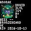

# World of Warcraft Plugin

Display Retail character stats from Raider.IO, or fresher stats from Blizzard’s official API, and the character’s actual Blizzard portrait as a pixel canvas. Text stats require FiestaBoard 9.0.0 or newer. Real avatar canvases require a pixel-capable build with Pillow (10.0.0-beta.59 or newer on `next`).



Captured from FiestaBoard’s rendered 64×64 output: a generated Druid portrait beside real Raider.IO stats for the Anorak–Bronzebeard demo. This is a rendering of the sent frame, not a photograph of the device.

**→ [Setup Guide](./docs/SETUP.md)**

## Overview

Track one configurable Retail character with the public [Raider.IO API](https://raider.io/api) — no API key required — or, with a free Battle.net API client, [Blizzard’s Profile API](#fresher-data-with-blizzards-api-optional). Character data updates periodically; this plugin exposes both the source update time and the time FiestaBoard fetched it.

## Fresher data with Blizzard’s API (optional)

Raider.IO only changes when it re-crawls a character, which can take hours or days. Blizzard’s official Profile API updates **when the character logs out**, so the board reflects each play session. It needs a free Battle.net API client; no Battle.net login or OAuth redirect is involved.

1. Sign in at [develop.battle.net](https://develop.battle.net/access/clients), open **API Access**, and create a client. Any redirect URL works (for example `https://localhost`); the plugin uses the client-credentials grant only.
2. Paste the **client ID** and **client secret** into the plugin settings. Leave **Data source** on `auto`.
3. Use the realm **slug** from your Armory URL (`worldofwarcraft.blizzard.com/…/character/eu/argent-dawn/name`). Latin realm names are converted automatically; Russian, Korean and Taiwanese realms must be entered as the slug.

What changes with Blizzard as the source:

- `source` is `Blizzard`, `source_short` is `BNET`, and `profile_url` links to the Armory.
- `source_updated_at` is the character’s last logout. `OLD DATA` means no logout in seven days.
- `mythic_score` is Blizzard’s Mythic+ rating, which can differ slightly from the Raider.IO score. `healer_score` is not provided (null).
- `role` comes from the active specialization. `weekly_runs` are this week’s best runs; `short_name` is empty.
- `raids` lists every raid in Blizzard’s *Current Season* group (falling back to the newest expansion), summarized at the highest difficulty with a kill.
- The avatar uses Blizzard’s character-media portrait with the same trusted-host checks and cache.

Each refresh makes four API calls (five if a rejected token is renewed) plus a token request about once a day, far below Blizzard’s limits. Both credentials are stored as masked settings and never appear in variables or errors. Filling in only one of the two is rejected so a paste error cannot silently fall back to Raider.IO. Set **Data source** to `raiderio` to keep the credentials but use Raider.IO, or `blizzard` to require Blizzard.

## Template Variables

Prefix all variables with `wow.`. Numeric values are null when unknown; the corresponding display variables show `--`. A reported score of zero remains zero.

| Variable | Meaning |
|---|---|
| `name` | Character name |
| `realm` | Realm |
| `region` | Region |
| `class` | Class |
| `spec` | Active specialization |
| `role` | Active role (TANK, HEALING or DPS) |
| `race` | Race |
| `faction` | Faction |
| `guild` | Guild |
| `achievement_points` | Achievement points |
| `item_level` | Equipped item level; null when unavailable |
| `item_level_display` | Rounded item level or -- |
| `season` | Current Mythic+ season (Raider.IO slug or Blizzard season ID) |
| `mythic_score` | Overall current-season Mythic+ score (Raider.IO score or Blizzard rating); null when unavailable |
| `mythic_score_display` | Rounded score or -- |
| `healer_score` | Current-season healer score (Raider.IO only); null when unavailable |
| `weekly_highest_key` | Highest completed key this week, including untimed runs |
| `weekly_highest_timed_key` | Highest timed key this week |
| `weekly_key_display` | Highest completed key formatted as +N, or -- |
| `raid_progress` | Current-tier raid summaries, separated by | |
| `source` | Data provider name: Raider.IO or Blizzard |
| `source_short` | Short provider label: RIO or BNET |
| `profile_url` | Raider.IO or Blizzard Armory character profile link |
| `source_updated_at` | Raider.IO crawl time, or the character’s last logout for Blizzard |
| `source_updated_date` | Source date, YYYY-MM-DD, or UNKNOWN |
| `source_age_days` | Age of the source snapshot in days; null if unknown |
| `fetched_at` | Timestamp of our last successful fetch, not the source update time |
| `stale` | True when showing a saved snapshot after a failed refresh |
| `status` | OK, OLD DATA (source older than seven days), or STALE (refresh failed) |
| `avatar_canvas` | Actual Blizzard portrait as pixel canvas content; null when unavailable |
| `avatar_status` | OK, STALE (cached portrait), or UNAVAILABLE |
| `avatar_url` | Source Blizzard image URL for the displayed portrait |

`weekly_runs` contains dungeon, short_name, level, timed, and score. `raids` contains slug, name, summary, total_bosses, normal_bosses_killed, heroic_bosses_killed, and mythic_bosses_killed. Index arrays as `{{wow.raids.0.summary}}`.

## Example Templates

```text
{{wow.name}}
{{wow.spec}} {{wow.class}}
ILVL {{wow.item_level_display}}  M+ {{wow.mythic_score_display}}
WEEK {{wow.weekly_key_display}}
{{wow.raid_progress}}
{{wow.source_short}} {{wow.source_updated_date}}
```

[Pixoo character and AI art example](./examples/pixoo-character-and-art.json) reserves a smaller canvas beside the stats. It requires the separate Generative AI Art plugin and a pixel-capable FiestaBoard build with page canvases. Create a named `wow` instance of Generative AI Art, configure and enable it independently, then set its custom theme to your character's class, race and specialization, such as “World of Warcraft Restoration Druid, emerald healing magic, moonlit forest, bold silhouette, no lettering.” The example uses `{{generative_ai_art:wow.canvas}}`, keeping its theme separate from the base art instance. Canvases sharing the same instance share its artwork; create different instances for different themes. The image is scaled into the region; native generation at that region's dimensions is not provided by this stats plugin. Save a generated image as the canvas's content fallback to keep it visible while the art source refreshes.

Numbers in the registry previews are illustrative. The running plugin always reads API data; it does not generate stats with AI. A character's active spec can differ from the role used for previous runs.

## Real character avatar

Add a canvas to your page and set its **Source** to `{{wow.avatar_canvas}}`. The plugin downloads the Blizzard thumbnail supplied by Raider.IO and converts that actual image into pixels. No AI generation, API key, or additional art plugin is required.

- **Beside stats:** use the [character and avatar example](./examples/pixoo-character-and-avatar.json). Its portrait region is 31×29 physical pixels on a 64×64 Pixoo using the 3×5 font. The default square portrait fits inside it. For a crop that fills the entire rectangle, set avatar width to 31 and height to 29.
- **Whole display:** use the [full-display example](./examples/pixoo-avatar-full-display.json), with width and height set to 64. Its canvas covers all 10 rows and 16 columns, with bleed on all sides to reach all 64×64 pixels.
- **Resize:** the page canvas’s area controls placement and on-screen size. Plugin **Avatar pixel width/height** controls source detail, independently, from 1 to 128 each. Rectangular sources use a centered crop without stretching. Keep 64×64 when sharing one square portrait across small and large regions; each region fits it automatically. Canvas scale above 1 makes bigger pixel blocks.

The converter reduces the portrait to at most 62 colors and avoids dithering for clear LED pixels. Fine facial detail is limited by both the source thumbnail and your chosen canvas area; there is no AI reconstruction.

The original image is cached in memory. A changed URL or Raider.IO source timestamp refreshes it, and an unchanged source is rechecked after six hours. A failed image refresh keeps the last good portrait with `avatar_status=STALE`; stats continue independently. Changing characters clears the portrait cache. After restart, a failed first download returns a null canvas: save known-good canvas content as the page’s fallback if you want an image during that interval. The existing AI-art example remains available for themed generated artwork.

## Configuration

| Setting | Default | Description |
|---|---|---|
| `region` | `eu` | Retail region: eu, us, kr, tw |
| `realm` | Required | Realm name or slug from the profile URL |
| `data_source` | `auto` | `auto` (Blizzard when credentials are set, else Raider.IO), `raiderio`, or `blizzard` |
| `client_id` | Empty | Optional Battle.net API client ID |
| `client_secret` | Empty | Optional Battle.net API client secret |
| `character` | Required | Exact character name, including accents |
| `refresh_seconds` | `900` | Poll interval, 300–86400 seconds |
| `avatar_width` | `64` | Source pixel width, 1–128 |
| `avatar_height` | `64` | Source pixel height, 1–128 |

## Features

- Retail character identity, equipped item level, achievements and guild.
- Current-season overall and healer Mythic+ scores.
- Highest completed and highest timed weekly keys, kept separate.
- Progress for all raids returned for the current tier.
- Last successful snapshot retained after failed refreshes, explicitly marked STALE.
- Server Retry-After respected on HTTP 429; short request timeout.
- Text output adapts to the board's rows and columns.
- Composes with a separate AI-art canvas on pixel displays.

Neither source is live in-game telemetry. This is not live combat telemetry, a complete weekly run history, or a Great Vault tracker. Raider.IO returns up to ten highest weekly runs, not every run. Empty arrays mean no records returned, not proof that the character has done no content. Old source snapshots show OLD DATA. Public-facing uses must retain a [Raider.IO](https://raider.io) attribution link; `profile_url` provides a character-specific link.

## Author

FiestaBoard Team. World of Warcraft is a trademark of Blizzard Entertainment. This community integration is not affiliated with Blizzard or Raider.IO.
